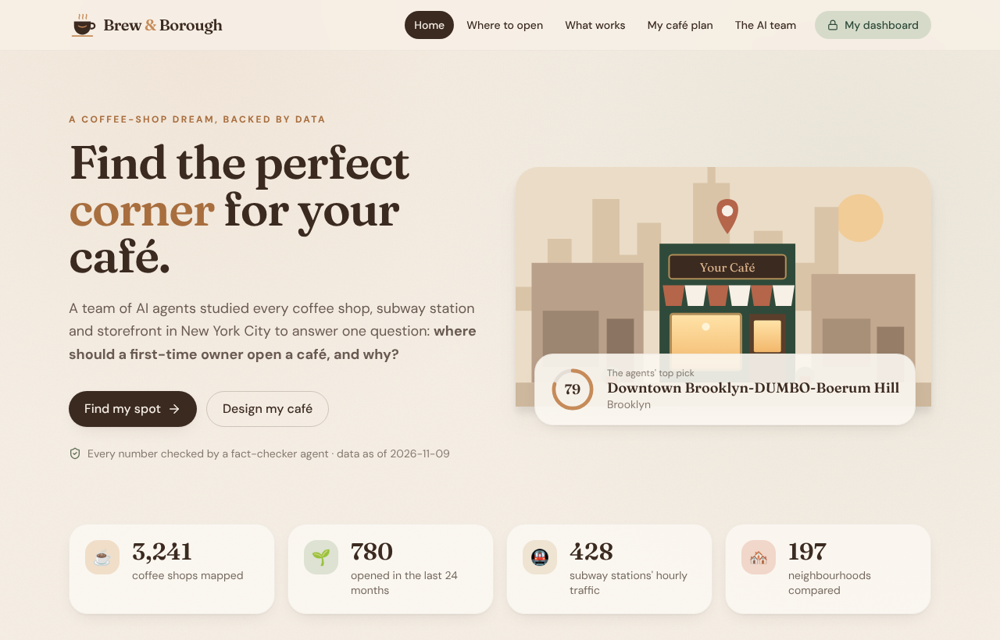
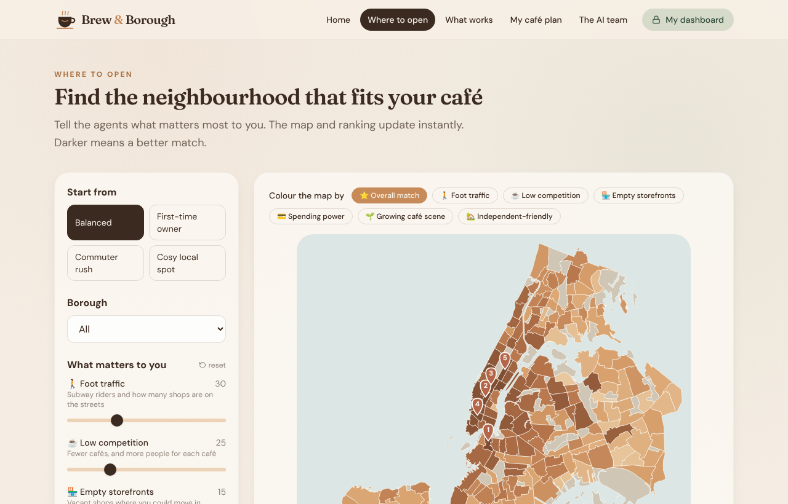
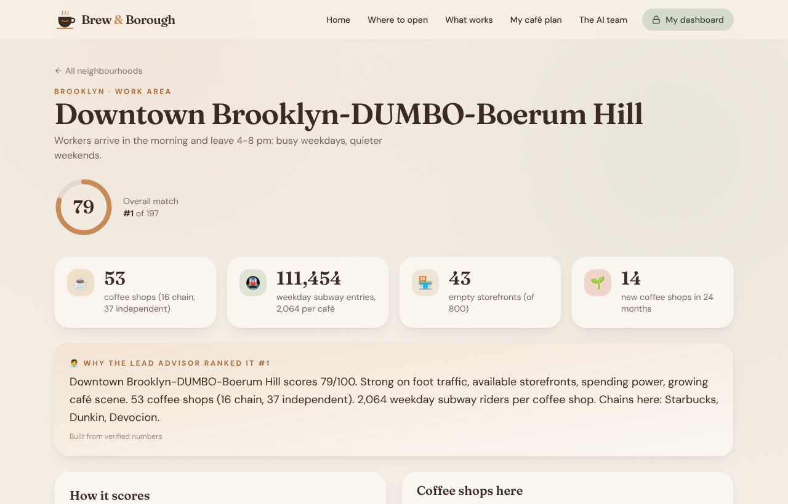
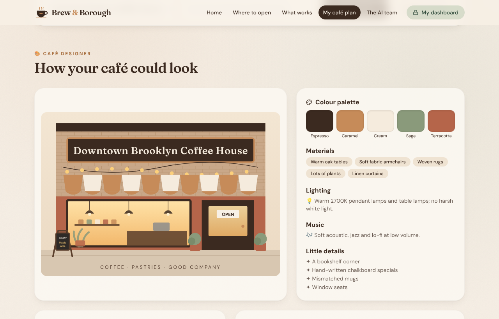
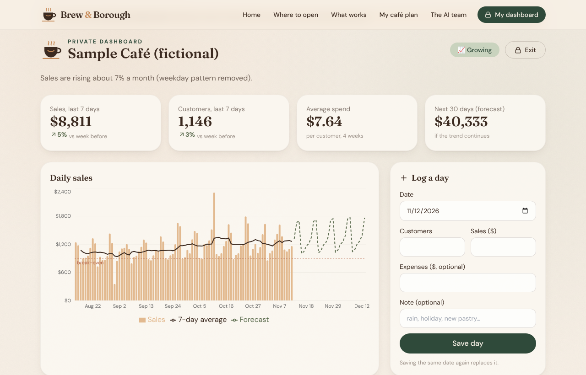

# Brew & Borough: Multi-Agent Market Research for a New York Coffee Shop


A team of AI agents studies **every coffee shop, subway station and storefront in New York City** to answer one question:
**where should a first-time owner open a café, and why?** It then helps plan the café (hours, prices, how to stand out,
risks, break-even, and how it could look), and includes a **private dashboard** to track the café once it's open.

**▶ Live website:** https://malihashaik68.github.io/multi-agent-market-research/



## Two parts

| Part | What it does |
|---|---|
| ☕ **Plan my café** (research) | Ranks 197 NYC neighbourhoods on foot traffic, competition, empty storefronts, spending power, new-café momentum and how independents do. Interactive map with your own priorities, neighbourhood reports, side-by-side comparison, lessons on what makes cafés succeed or fail, a business plan, a break-even calculator and a design concept (storefront, colours, floor plan). |
| 🔒 **My dashboard** (private) | Log customers and sales each day. Growing, steady or declining (weekday pattern removed), unusual-day alerts, weekday pattern, 30-day forecast, break-even line and advice. **Data never leaves the device**: encrypted with the owner's PIN (PBKDF2 + AES-GCM) and stored only in the browser, with CSV backup/import. |

<p>




</p>

## The agents

| Agent | Job | How |
|---|---|---|
| 🔎 Competitor Analyst | Every coffee shop, chains vs independents, under-served and crowded areas | SQL over 3,241 coffee shops |
| 📈 Trend Analyst | Where cafés opened in the last 24 months, and who opened them | Pre-opening health inspections |
| 📍 Location Scout | Foot traffic by hour, home vs work areas, storefront vacancy, income | MTA hourly ridership, storefront registry |
| ✅ Operations Analyst | What well-run cafés do and what gets cafés closed | Health grades, violations, closures |
| 🧑‍💼 Lead Advisor | Coordinates the team, ranks neighbourhoods, asks each specialist for a brief on the top candidates, writes the recommendation | Weighted scoring + specialist briefs |
| 🧾 Business Planner | Hours, price level, how to stand out, risks, for every neighbourhood | Rules on the data (+ LLM ideas for top picks) |
| 🎨 Café Designer | Style, palette, materials, layout matched to the area type | Design concepts rendered as SVG |
| 🛡️ Fact-Checker | Re-runs the SQL behind every number, and rejects any LLM text containing a number that isn't in the findings | 49/49 checks verified in the latest run |

```
          ┌──────────────── Lead Advisor ────────────────┐
          │  ranks neighbourhoods, requests briefs,       │
          │  writes the recommendation                    │
          └──┬──────────┬───────────┬───────────┬────────┘
   Competitor   Trend      Location    Operations     ← each answers with SQL findings
          └──────────┴──── findings (value + SQL) ──┘
                              │
                        Fact-Checker  → re-runs every query, checks every written number
                              │
             Planner · Designer → plan + design for each neighbourhood
                              │
          web/public/data/*.json  →  React website (GitHub Pages)
          outputs/report.md, outputs/market_research.xlsx (for Excel / Power BI)
```

**The LLM never calculates.** Every number comes from SQL (read-only SQLite: writes, `ATTACH` and multiple
statements are refused). The LLM (Groq free tier, optional; the best available model is picked automatically) only phrases the findings, and the
Fact-Checker replaces any text that adds a number it can't verify. Without a key, every agent still runs and writes
from templates.

## Data (public, no keys)

| Source | Used for |
|---|---|
| [NYC DOHMH Restaurant Inspections](https://data.cityofnewyork.us/d/43nn-pn8j) | Coffee shops, chains, health grades, violations, closures, new openings |
| [MTA Subway Hourly Ridership (2025+)](https://data.ny.gov/d/5wq4-mkjj) | Weekday/weekend entries per station and hour |
| [NYC Storefronts Reported Vacant or Not](https://data.cityofnewyork.us/d/92iy-9c3n) | Storefronts and vacancies per neighbourhood |
| [NYC Neighborhood Financial Health](https://data.cityofnewyork.us/d/r3dx-pew9) | Median income by community district (2020) |
| [2020 Neighborhood Tabulation Areas](https://data.cityofnewyork.us/d/9nt8-h7nd) | Neighbourhood boundaries and names |

Cafés and stations are placed in neighbourhoods with a point-in-polygon join (Shapely). Each measure becomes a
0-100 percentile score; the overall match is a weighted average that users can re-weight on the website.

## Findings (latest run)

- 3,241 coffee shops; 34% are chain branches (Dunkin 544, Starbucks 252).
- 780 coffee shops opened in the last 24 months, and 84% of them are independent.
- 95% hold an A grade; 4% were temporarily closed by inspectors, and 66% of those had pest problems.
- Top picks (balanced priorities): Downtown Brooklyn-DUMBO-Boerum Hill, Midtown South-Flatiron-Union Square,
  Midtown-Times Square, SoHo-Little Italy-Hudson Square, Upper East Side-Carnegie Hill. Best in Queens: Long
  Island City-Hunters Point; Bronx: Mott Haven-Port Morris.

Full report: [outputs/report.md](outputs/report.md) · Excel workbook for Power BI: `outputs/market_research.xlsx`.

## Run it

```bash
python -m venv .venv && source .venv/bin/activate
pip install -r requirements.txt
python -m market_research.pipeline            # downloads data on first run (~1 min), runs all agents
GROQ_API_KEY=... python -m market_research.pipeline   # optional: LLM-written explanations
pytest -q

cd web && npm install && npm run dev          # website at http://localhost:5173
```

A GitHub Action refreshes the data and re-runs the agents every Monday; another deploys the website to GitHub Pages.

## Tests

- **Python (15):** café classification, chain grouping, read-only SQL, the fact-checker catching wrong and invented
  numbers, scoring, the planner's rules, and consistency of the published results.
- **Dashboard (9):** week-over-week change, growth vs decline (with weekday pattern removed), unusual-day alerts,
  break-even warnings, forecast, advice, sample data, CSV backup round-trip.

## Honest limits

- **Rent isn't public**, so it isn't in the score; central Manhattan is flagged as "very high rents likely". The
  break-even calculator uses the owner's own numbers.
- **Closed cafés disappear from city records**, so survival rates can't be measured; "what fails" uses health
  closures, violations and crowding instead.
- Subway entries measure people **entering** stations (work areas peak in the evening, home areas in the morning).
- Income is from the 2020 Neighborhood Financial Health profile; a café is "new" if its pre-opening inspection was in
  the last 24 months.
- The illustrations are design concepts, not renderings of a real space.
- Research and ideas, not financial advice.

## Project structure

```
market_research/
  fetch.py            download public datasets (cached in data/raw/)
  build.py            clean, classify, spatial join, scores → SQLite + JSON
  tools.py            read-only SQL tool shared by the agents
  llm.py              optional Groq client (key from the environment)
  agents/             competitor, trend, location, operations, advisor, planner/designer, fact-checker
  pipeline.py         runs the team, writes web data + report + Excel
web/                  React + TypeScript + Tailwind website (Vite), Recharts, d3-geo map
  src/dashboard/      private on-device dashboard (analytics + encrypted storage)
tests/                pytest
```
